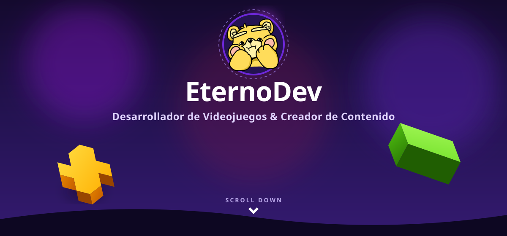
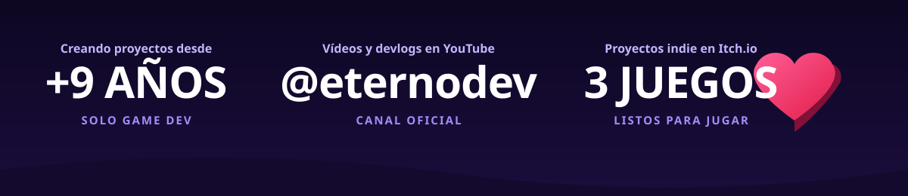

  <!-- 1. HERO BANNER ESTILO CRAZYGAMES CON FORMAS 3D FLOTANTES -->
  

  <!-- 2. BANNER DE MÉTRICAS / ESTADÍSTICAS EN CASCADA -->
  

 

  <!-- BOTONES DE ACCIÓN DIRECTA -->
  

    
    &nbsp;&nbsp;
    
    &nbsp;&nbsp;
    
  

 

---

## 🎬 Vídeos Destacados de YouTube

> Haz clic en cualquier portada para ver el devlog o reto de programación en YouTube:

<table>
  <tr>
    <td width="50%" align="center">
      <a href="https://www.youtube.com/watch?v=wjoGjOxCTCQ" target="_blank">
        
         
        <h3>¡REHICE el Juego de mis SUEÑOS! — DevBlog 2</h3>
      </a>
      
<i>¡Pummm! ¿Otra vez luchando contra los errores de Unity?</i>

    </td>
    <td width="50%" align="center">
      <a href="https://www.youtube.com/watch?v=DFR5UtAuHTw" target="_blank">
        
         
        <h3>Sobreviví a mi PRIMERA GameJam</h3>
      </a>
      
<i>¡Ding! Espera... ¿La Global Game Jam 2025? Crónica completa.</i>

    </td>
  </tr>
  <tr>
    <td width="50%" align="center">
      <a href="https://www.youtube.com/watch?v=bRbhRWQvqs8" target="_blank">
        
         
        <h3>Hice un VTUBER en 48 HORAS</h3>
      </a>
      
<i>Reto exprés de arte, modelado y programación en tiempo récord.</i>

    </td>
    <td width="50%" align="center">
      <a href="https://www.youtube.com/watch?v=F1-R5hIjGLM" target="_blank">
        
         
        <h3>¡Creando Mi Propio JUEGO Desde CERO! — DevBlog 1</h3>
      </a>
      
<i>El inicio del viaje indie: mecánicas, diseño y primeros errores.</i>

    </td>
  </tr>
</table>

  <a href="https://www.youtube.com/@eternodev">
    <b>👉 Ver todos los vídeos y devlogs en youtube.com/@eternodev →</b>
  </a>

 

---

## 🕹️ Videojuegos Indie en Itch.io

Juega directamente desde el navegador o descarga mis creaciones:

<table>
  <tr>
    <td align="center" width="33%">
      <b>🗡️ CastleCat RPG</b>  
      <i>¡Naciste gato, pero morirás como leyenda! RPG táctico y divertido para navegador.</i>  
      <a href="https://eternodev.itch.io">▶️ Jugar en Itch.io</a>
    </td>
    <td align="center" width="33%">
      <b>🥊 Oonga Bunga!</b>  
      <i>Compite con tus amigos para convertirte en el líder de la tribu. ¡Solo habrá un ganador!</i>  
      <a href="https://eternodev.itch.io">▶️ Jugar en Itch.io</a>
    </td>
    <td align="center" width="33%">
      <b>🧼 Soap Dodger</b>  
      <i>Agudiza tus reflejos en este peliagudo Bullet Hell arcade. No pierdas bocanadas de aire.</i>  
      <a href="https://eternodev.itch.io">▶️ Jugar en Itch.io</a>
    </td>
  </tr>
</table>

 

---

## 💻 Software & Herramientas Web

Además de juegos, creo herramientas útiles para creadores y desarrolladores en [**eternodev.com**](https://eternodev.com):

- 💡 **[BrightLight](https://eternodev.com)**: Control de iluminación multi-luz sincronizado mediante Web Bluetooth API sin instalaciones previas.
- 🎬 **[EditFun](https://eternodev.com)**: Grabación limpia y utilidades sin anuncios para editores de vídeo y creadores de contenido.
- 📋 **[Etern-Notes](https://eternodev.com)**: Gestor Kanban y bloc de notas de alta velocidad multiplataforma (Windows, Linux, macOS).

 

---

  
¿Quieres colaborar o charlar sobre desarrollo de videojuegos?

  <a href="https://eternodev.com">🌐 <b>eternodev.com</b></a> &nbsp;•&nbsp; 
  <a href="https://www.youtube.com/@eternodev">📺 <b>YouTube</b></a> &nbsp;•&nbsp; 
  <a href="https://eternodev.itch.io">🎮 <b>Itch.io</b></a> &nbsp;•&nbsp; 
  <a href="mailto:paucremades06@gmail.com">✉️ <b>paucremades06@gmail.com</b></a>
    
  © 2026 EternoDev • @eternodev

