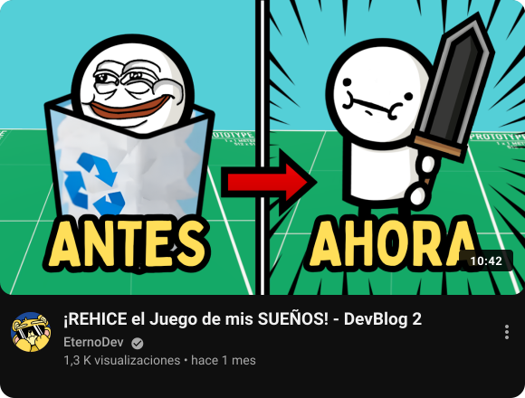
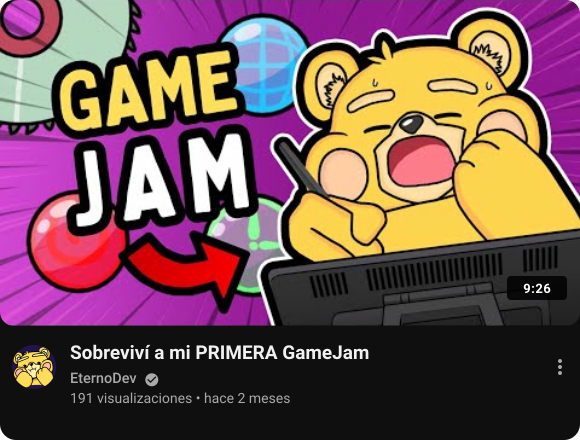
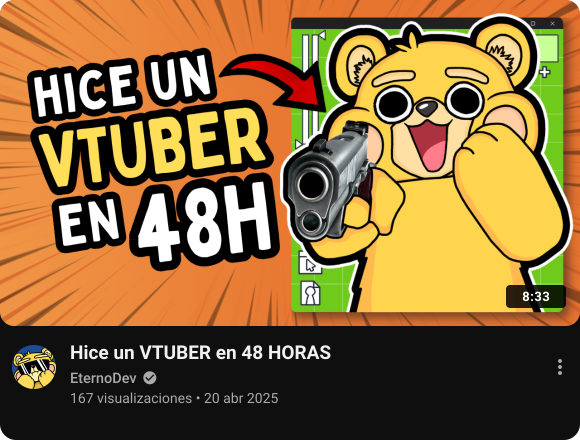
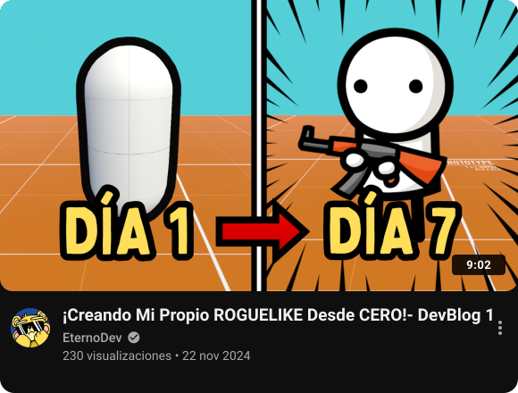

  <!-- CABECERA AMARILLA (#FBDA50) CON DEGRADADOS, LOGO ETERNODEV Y BOTÓN OPEN WEB BLANCO -->
  

    

  <!-- TÍTULO DE SECCIÓN ESCRITO EN MARKDOWN CON ENLACE DIRECTO A YOUTUBE -->
  <h2>
    Vídeos de 
  </h2>

   

  <!-- FEED 2x2 SIN BORDES DE TABLA (PÁRRAFOS CENTRADOS) -->
  

    
    &nbsp;
    
  

  

    
    &nbsp;
    
  

